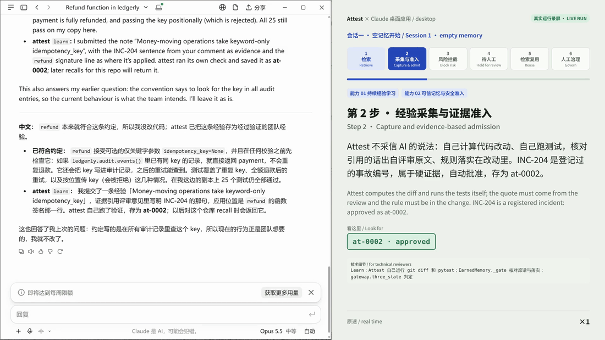
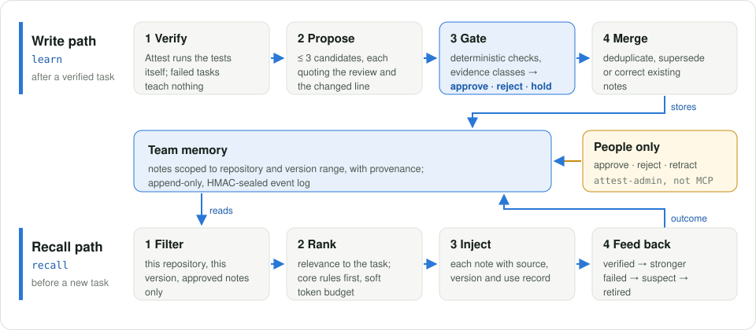

<div align="center">

# Attest

**Verified, scoped, retractable memory for coding agents.**

Coding agents learn from code review, but only what a verified change actually applied,
only within the repository and version it came from, and only until a person retracts it.

[](https://github.com/tonglynn/attest-agent-memory/actions/workflows/ci.yml)
[](LICENSE)
[](pyproject.toml)
[](attest/mcp_server.py)
[](https://tonglynn.github.io/attest-agent-memory/)

[**Live demo**](https://tonglynn.github.io/attest-agent-memory/) ·
[**5-minute recording**](docs/attest_mcp_live.mp4) ·
[**Full write-up**](ASSESSMENT.md) ·
[**简体中文**](README.zh-CN.md)

</div>

<p align="center">
  
  <br>
  <sub>A live session with Claude and the Attest MCP server: a rule is learned, a test-passing bad rule is rejected,
  an unsupported one waits for a person, and recall follows the people's decisions.</sub>
</p>

## Why

Coding agents keep repeating mistakes that review already corrected. Memory systems built
to fix this usually store whatever the agent concluded, apply it everywhere and never take
it back. A plausible but wrong suggestion that happens to pass the tests then becomes a
permanent rule.

Attest treats every memory as a claim that needs evidence:

- **Learn only from verified work.** Attest runs the verification command itself. A note
  must quote the review comment it came from and point to the changed line that applied it.
- **Decide deterministically.** An evidence gateway approves, rejects, or holds a note for a
  person. No model call decides what becomes a rule.
- **Stay in scope.** Every note is bound to a repository and a version range, so it is never
  recalled in another codebase or after a policy changed.
- **Keep people in charge.** Only people approve, reject, supersede or retract, through a
  command line the agent has no access to. Every change goes to an append-only, HMAC-sealed log.

## Results

| | Result | Source |
|---|---|---|
| **Learns** | Held-out first-attempt pass rate **33% → 70%** (+36 pp [+21, +52]) on tasks it never learned from | Preregistered main experiment, [`runs/main`](runs/main) |
| **Is not taught wrong** | Test-passing poisoned advice stored as a rule **0/60** times (no gate: 46/60, ACE-style: 38, ReasoningBank-style: 50) | [`runs/poison_channels`](runs/poison_channels) |
| **Costs nothing on clean work** | With the evidence gateway: 82% pass@1, same as no gate, +9 pp over the preregistered gate | [`runs/gate_confirm`](runs/gate_confirm) |
| **Stays in scope** | **0** foreign notes leaked into a control repository (54 without scoping) | [`runs/main`](runs/main) |
| **Follows policy change** | Tasks after a policy change **+67 pp** with versioned notes | [`runs/main`](runs/main) |

<p align="center">
  
</p>

Negative results are reported as well: the preregistered write gate cost −15 pp
(hypothesis H6 not supported), and failure attribution remains unsolved. See [Limits](#limits).

## How it works

<p align="center">
  
</p>

- **Write path** (`learn`, after a verified task): the model proposes at most three
  candidates, each quoting the review and the changed line; deterministic checks and the
  evidence gateway decide *approve*, *reject* or *hold for a person*; approved notes are
  merged with, supersede, or correct existing ones.
- **Recall path** (`recall`, before a new task): filter by repository, version range and
  status; rank against the task with core rules first under a soft token budget; inject each
  note with its provenance; feed the outcome back (verified → stronger, failed → suspect → retired).
- **Human governance**: approval and retraction exist only in `attest-admin`. The MCP server
  exposes no approve or retract tool, and an agent cannot approve its own notes.

## Quick start

Install the MCP server and connect it to an agent:

```bash
pip install "git+https://github.com/tonglynn/attest-agent-memory"
claude mcp add attest -- attest-mcp        # Claude Code; any MCP client works the same way
```

The agent receives four tools:

| Tool | Called | What it does |
|---|---|---|
| `recall` | before a task | Returns the approved notes for this repository and version, with provenance |
| `learn` | after an accepted change | Runs verification, computes the diff, and sends candidate notes through the gate |
| `report_outcome` | when the task ends | Records which notes were used and whether the work passed |
| `list_notes` | any time | Lists the notes kept for the repository |

People review what the gateway held back, and approve, reject or retract:

```bash
export ATTEST_APPROVERS=owner:finance-lead
attest-admin review  --repo .
attest-admin approve --repo . --note at-0004 --by owner:finance-lead --reason "Finance needs the ticket id"
attest-admin retract --repo . --note at-0002 --reason "Policy changed"
```

<details>
<summary><b>Configuration</b></summary>

| Variable | Default | Meaning |
|---|---|---|
| `ATTEST_HOME` | `~/.attest` | Where memory is stored, one store per repository |
| `ATTEST_STORE` | `sqlite` | `sqlite` (shared by several agents or people) or `jsonl` |
| `ATTEST_VERIFY_CMD` | `python -m pytest -q` | Verification command, set by the person who configures the server, never by the agent |
| `ATTEST_GATEWAY` | `checks` | `checks` runs the evidence gateway; `off` keeps only the preregistered write gate |
| `ATTEST_ALLOWED_REPOS` | *(all)* | Comma-separated repository keys the server may serve |
| `ATTEST_SECRET_SCAN` | `1` | Reject notes that contain secrets |
| `ATTEST_APPROVERS` | *(none)* | Names allowed to approve with `attest-admin` |

</details>

## Reproduce the experiments

```bash
git clone https://github.com/tonglynn/attest-agent-memory && cd attest-agent-memory
pip install -r requirements.txt && pip install -e . --no-deps
python -m pytest -q                        # offline, no API key needed
python scripts/mcp_demo.py                 # end-to-end MCP demo with a scripted model

export DEEPSEEK_API_KEY=...                # model runs only
python -m attest experiment --name main    # the preregistered experiment
```

Every run behind the numbers above is committed under [`runs/`](runs/) with its
trajectories, diffs, results and memory logs. The experiments also run on GitHub Actions
through the [`experiment`](.github/workflows/experiment.yml) workflow.

## Documentation

| Document | Contents |
|---|---|
| [`ASSESSMENT.md`](ASSESSMENT.md) | Full write-up: problem, method, every experiment, design decisions |
| [`RESULTS.md`](RESULTS.md) | All results, including negative and null ones, with run directories |
| [`PREREGISTRATION.md`](PREREGISTRATION.md) | Hypotheses and analysis plan, frozen before any memory run |
| [`DECISIONS.md`](DECISIONS.md) | Decision log D1–D79 |
| [`SCENARIO.md`](SCENARIO.md) | The synthetic billing codebase and its team rules |
| [`docs/MCP_DEMO.md`](docs/MCP_DEMO.md) | Using Attest from a real agent |

| Path | Contents |
|---|---|
| `attest/memory/` | Write gate, evidence gateway, retrieval, lifecycle, stores (JSONL, SQLite) |
| `attest/mcp_server.py` · `attest/admin.py` | MCP server for agents; command line for people |
| `benchmark/` | 25-task benchmark on a synthetic billing codebase |
| `runs/` | Every experiment run |
| `docs/app/` | Source of the interactive demo |

## Limits

One model (DeepSeek), one synthetic benchmark designed by the author, simulated review
comments, 11 held-out tasks × 3 repetitions. The gate checks that the evidence line is a
real verified change, not that it is about the rule. Process rules that a diff cannot show
(rebase, backport) are out of reach. All repositories, review comments, policies and attack
material are synthetic and labelled as such.

## Contributing

Issues and pull requests are welcome; see [CONTRIBUTING.md](CONTRIBUTING.md). Please report
security issues privately as described in [SECURITY.md](SECURITY.md).

## Citation

```bibtex
@software{lin2026attest,
  author  = {Lin, Tong},
  title   = {Attest: Verified, Scoped, Retractable Memory for Coding Agents},
  year    = {2026},
  version = {0.1.0},
  url     = {https://github.com/tonglynn/attest-agent-memory}
}
```

## License

[MIT](LICENSE). Attest started as a practical assessment for an AI-native development role;
the original write-up is kept in [`ASSESSMENT.md`](ASSESSMENT.md).
