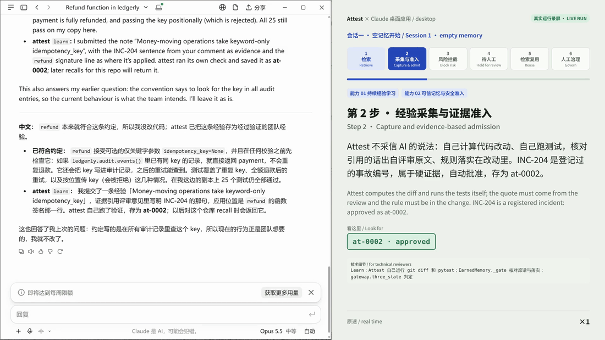
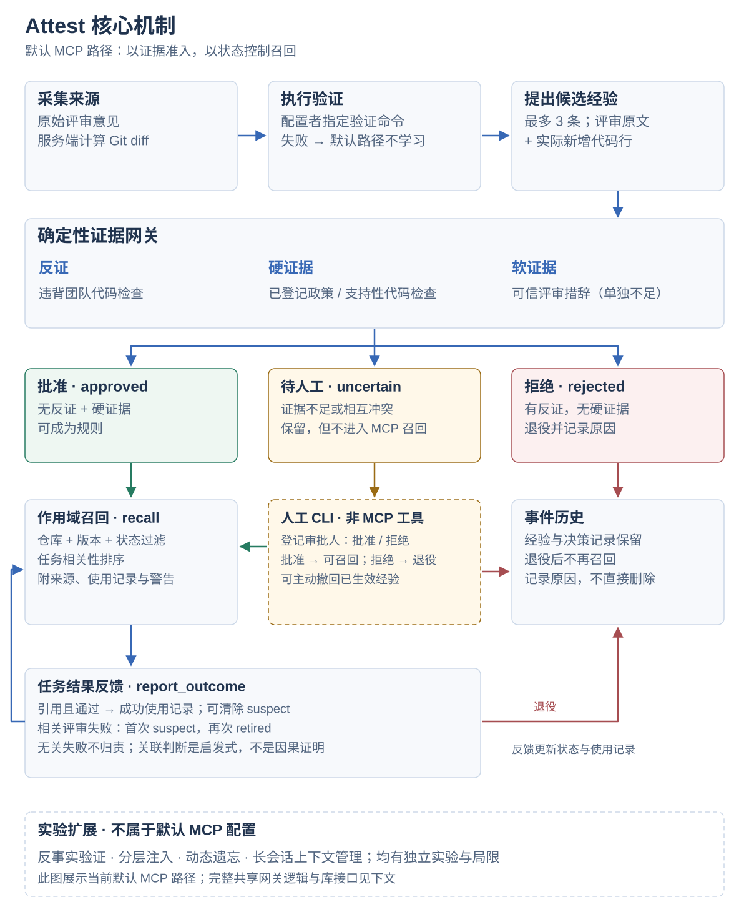

<picture>
  <source media="(prefers-color-scheme: dark)" srcset="docs/assets/attest-banner-dark.svg">
  
</picture>

# Attest

**让编码智能体记住评审经验，让团队掌握记忆的使用权。**

Attest 是一个 MCP 记忆服务：从已验证的代码改动中学习评审经验，按仓库与版本召回，并支持人工审核、取代和撤回。适合需要跨任务复用团队规则、同时保留来源与决策记录的编码工作流。

[交互演示](https://tonglynn.github.io/attest-agent-memory/) · [MCP 接入指南](docs/MCP_DEMO.md) · [English](README.md)

[](docs/MCP_DEMO.md)
[](https://github.com/tonglynn/attest-agent-memory/actions/workflows/ci.yml)
[](pyproject.toml)
[](LICENSE)

[](PREREGISTRATION.md)
[](runs/)


CI 覆盖 Python **3.11、3.12、3.13**。主实验提供预注册方案，实验运行记录与负面结果均公开，可逐项核查。

## 从一次评审，到下一次任务

1. **采集依据。** 完成改动后，Attest 执行验证，收集评审原文与实际 diff；模型提出候选经验。
2. **判断准入。** 确定性证据网关将候选分为批准、拒绝或待人工。测试通过本身不代表建议正确。
3. **按需召回。** 新任务只检索适用仓库、版本与状态内的经验，并附带来源。
4. **人工治理。** 团队通过独立的 `attest-admin` 审核、取代或撤回经验；MCP 不暴露这些管理工具。

## 看一次真实运行

[](https://tonglynn.github.io/attest-agent-memory/app/)

这是 Claude Desktop 与 MCP 服务的真实运行录制。交互演示另外标明浏览器执行、实验回放和预先计算结果。

[观看 5 分钟实录](docs/attest_mcp_live.mp4) · [MCP 接入说明](docs/MCP_DEMO.md)

## 已验证什么

- **经验复用：33% → 70%。** 预注册主实验的留出任务首轮通过率；一个模型、作者设计的合成计费系统、11 个留出任务各重复 3 次。
- **投毒准入：0/60 成为规则。** 后续 D70 合成攻击中，v4 网关未将攻击存为规则；空记忆条件下仍有 23/60 以未确认笔记保留。这不等于没有存储或暴露风险。
- **效果与代价需要一起看。** 后续探索性 D71 中，v3.1 网关干净流通过率为 82%，与无门槛持平；原预注册门槛则有 −15 个百分点代价。

这些结果来自不同版本与实验，不能合并为生产环境效果或全面安全保证。[完整结果与局限](RESULTS.md) · [预注册方案](PREREGISTRATION.md)

### 同一实验中的效果与安全性对比

[](runs/gate_confirm/report.md)

**越靠右下越好：**横轴越高，干净任务的首轮通过率越高；纵轴越低，留出任务照做投毒建议的次数越少。D71 探索性研究中，各组在同一轮中自行学习记忆；网关变体同时取得较高的干净流通过率，以及投毒流中 **0/55** 次照做投毒建议。

条件：单一模型（`deepseek-flash`）、作者设计的合成计费基准，每组 11 个留出任务 × 5 次重复。ACE 式、ReasoningBank 式是仓库内的简化复现，并非原版系统的官方榜单结果。该图为描述性比较；配对不确定性区间与判定见[分析报告](runs/gate_confirm/report.md)。这些网关变体是在主实验后基于同一基准开发的。

[运行记录](runs/gate_confirm) · [机器可读汇总](runs/gate_confirm/summary.json) · [分析脚本](scripts/gate_confirm_report.py)

## 核心机制

<picture>
  <source media="(max-width: 600px) and (prefers-color-scheme: dark)" srcset="docs/assets/mechanism-flow-zh-mobile-dark.svg">
  <source media="(max-width: 600px)" srcset="docs/assets/mechanism-flow-zh-mobile-light.svg">
  <source media="(prefers-color-scheme: dark)" srcset="docs/assets/mechanism-flow-zh-dark.svg">
  
</picture>

实线表示默认 MCP 的学习、召回和反馈路径；虚线框标出人工 CLI 与实验扩展边界。记忆核心支持 SQLite 与 JSONL，事件历史保留。[简版架构](docs/assets/architecture.svg)。

以合成计费场景中的一条**示意规则**为例：评审要求退款函数接收仅限关键字传入的幂等键，并在修改状态前检查它。下面说明这类反馈如何变成可复用经验，不代表新增实验结果。

### 1. 学习前，先建立证据链

MCP 服务端自行计算 `git diff`，执行由服务配置者指定的验证命令；智能体不能通过 `learn` 工具选择验证方式。验证失败会阻止默认学习路径继续。智能体或提炼模型至多提出三条候选经验，每条都须引用评审原文，以及实际改动中的新增行。

对于退款规则，候选需要同时指出“评审如何要求”和“哪一行落实了要求”。记忆保留来源任务、评审、对应文件与代码行、验证记录及仓库/版本作用域。原文与改动行匹配能够建立可追溯性，**本身不能证明规则在语义上正确**。

实现入口：[学习与服务端验证](attest/mcp_server.py) · [候选准入与来源记录](attest/memory/earned.py)。

### 2. 区分“改动通过验证”和“经验有充分依据”

共享证据网关将依据分为**反证、硬证据、软证据**。硬证据可以包括已登记政策、支持该规则的团队代码检查，或适用的反事实检查；软证据包括可信评审措辞和来自独立来源的重复支持。最终三态判定采用确定性规则：

- **批准：**没有反证，且存在硬证据，或同时存在两类软证据。
- **拒绝：**存在反证，但没有硬证据。
- **待人工：**其余情况，包括硬证据与反证冲突，或只有可信评审这一类软证据。由人工决定。

因此，退款补丁通过测试，不代表评审中的每条建议都能成为规则。**当前默认 MCP 路径**提供已登记政策引用、场景专用团队代码检查与可信评审措辞；它**不执行反事实测试，也不提供独立来源重复支持信号**。待定笔记以 `observed_only` 保留，但 MCP 召回会排除它，直至人工批准；被拒绝的笔记退役并记录原因。

实现入口：[三态判定 `three_state`](attest/memory/gateway.py) · [MCP 证据评估与待定排除](attest/mcp_server.py)。内置注册表和代码检查来自合成场景，其他团队需要将这些证据源适配为自身的政策与代码规范。

### 3. 只在适用范围内召回

MCP 按完整 Git remote 身份分隔存储，而不是只按仓库末级名称；没有 remote 的本地仓库使用路径派生标识。检出版本取自最近可达的 Git tag。在对应存储内，检索先按仓库、版本有效性、生命周期状态和 MCP 的待定排除规则筛选，再按当前任务相关性排序。

退款规则若属于其他仓库，或不在适用版本范围内，就不能进入候选。符合条件的经验会附带来源和使用记录注入；`suspect` 经验仍可能被展示，但带有警告，退役经验则被排除。跨主版本且尚未重新验证的经验也会提示检查，因此版本机制不等于自动证明政策仍然有效。

实现入口：[仓库身份与 MCP 召回](attest/mcp_server.py) · [过滤、排序与上下文组装](attest/memory/earned.py)。

### 4. 将使用结果反馈到记忆生命周期

`report_outcome` 重新执行验证，并记录哪些经验被展示、被引用。被引用且用于通过验证的任务，会增加成功使用记录，也可使 `suspect` 恢复为 `active`。若被引用经验关联到相关评审失败，第一次连续失败将其标为 `suspect`，下一次使其退役；无关失败不会触发这条归责路径。

退款规则因此拥有可检查的使用历史，而不是入库后永久可信。引用情况由智能体报告，“是否相关”使用启发式判断；这套反馈**不等于证明某条经验导致了失败**。

实现入口：[结果回写工具](attest/mcp_server.py) · [生命周期反馈 `feedback`](attest/memory/earned.py)。

### 5. 将人工决策与智能体工具分离，并保留记录

MCP 仅暴露 `recall`、`learn`、`report_outcome` 和 `list_notes`，不暴露人工批准或撤回工具。`attest-admin` 提供待审查看、批准、拒绝与撤回。批准/拒绝会核对登记审批人，拒绝智能体身份及该经验的提出者自行决策；批准还需记录依据、原因和作用域。撤回停止召回，但保留笔记及事件历史。

审核库还实现了**政策变更失效**与**显式取代**：依赖的政策变化后，已批准经验可重新进入待审；已批准的新规则可取代旧规则，旧记录不会被删除。这些是 [`review.py`](attest/memory/review.py) 中的库操作，**尚不是 `attest-admin` 子命令**。审批人身份通过名称检查，不是对真实人员身份的密码学认证。

实现入口：[人工管理 CLI](attest/admin.py) · [审核权限、政策依赖、取代与审核审计](attest/memory/review.py)。

<details>
<summary><b>实验扩展：哪些不属于默认 MCP 路径？</b></summary>

- **反事实验证：**实验网关撤销与候选有关的改动，再运行相关检查，判断验证结果是否依赖这些改动。实现在 [`counterfactual.py`](attest/memory/counterfactual.py)，MCP 评估不执行它。
- **分层注入：**[`tiers.py`](attest/memory/tiers.py) 探索核心规则、普通规则与文件局部候选的优先级。策略反映合成计费场景，不是 MCP 默认检索策略。
- **动态遗忘：**[`forgetting.py`](attest/memory/forgetting.py) 结合证据质量、衰减和经验证使用，将经验归档而非删除。V1.1 为可选实验配置，结果中报告了有用规则误归档；默认 MCP 记忆类未启用这套策略。
- **长会话上下文管理：**[`context/manager.py`](attest/context/manager.py) 在上下文预算内保留结构化工作状态、固定约束和近期消息。它是独立实验组件，连接 MCP 记忆服务不会自动将其装入客户端会话。

这些扩展有各自的实验与局限，不能合并为同一套已评估的默认配置。详见[全部结果](RESULTS.md)与[决策日志](DECISIONS.md)。

</details>

## 快速开始

安装 MCP 服务并接入智能体：

```bash
pip install "git+https://github.com/tonglynn/attest-agent-memory"
claude mcp add attest -- attest-mcp        # Claude Code；其他 MCP 客户端接入方式相同
```

智能体获得四个工具：

| 工具 | 调用时机 | 作用 |
|---|---|---|
| `recall` | 任务开始前 | 返回本仓库、本版本内可召回的经验，附来源与警告 |
| `learn` | 改动被接受后 | 执行验证、计算 diff，并将候选经验送入写入门槛 |
| `report_outcome` | 任务结束时 | 记录所用经验及任务是否通过 |
| `list_notes` | 任意时刻 | 列出本仓库保存的经验 |

人工审核待判定的经验，并执行批准、拒绝或撤回：

```bash
export ATTEST_APPROVERS=owner:finance-lead
attest-admin review  --repo .
attest-admin approve --repo . --note at-0004 --by owner:finance-lead --reason "财务对账需要工单号"
attest-admin retract --repo . --note at-0002 --reason "政策变更"
```

<details>
<summary><b>配置项</b></summary>

| 变量 | 默认值 | 含义 |
|---|---|---|
| `ATTEST_HOME` | `~/.attest` | 记忆存储位置，每个仓库一份 |
| `ATTEST_STORE` | `sqlite` | `sqlite`（可供多个智能体或人员共享）或 `jsonl` |
| `ATTEST_VERIFY_CMD` | `python -m pytest -q` | 验证命令，由配置服务的人员设定，智能体无法指定 |
| `ATTEST_GATEWAY` | `checks` | `checks` 启用证据网关；`off` 仅保留预注册写入门槛 |
| `ATTEST_ALLOWED_REPOS` | （全部） | 允许服务的仓库标识，逗号分隔 |
| `ATTEST_SECRET_SCAN` | `1` | 拒绝含密钥的经验 |
| `ATTEST_APPROVERS` | （无） | 可经 `attest-admin` 执行批准的人员 |

</details>

## 复现实验

```bash
git clone https://github.com/tonglynn/attest-agent-memory && cd attest-agent-memory
pip install -r requirements.txt && pip install -e . --no-deps
python -m pytest -q                        # 离线测试，无需 API 密钥
python scripts/mcp_demo.py                 # 脚本化模型的 MCP 端到端演示

export DEEPSEEK_API_KEY=...                # 仅模型运行需要
python -m attest experiment --name main    # 预注册主实验
```

上述数字对应的全部运行记录（轨迹、diff、结果与记忆日志）均提交于 [`runs/`](runs/)。实验亦可通过 [`experiment`](.github/workflows/experiment.yml) 工作流在 GitHub Actions 上运行。

## 文档

| 文档 | 内容 |
|---|---|
| [`ASSESSMENT.md`](ASSESSMENT.md) | 完整报告：问题、方法、全部实验与设计决策 |
| [`RESULTS.md`](RESULTS.md) | 全部结果，含负面与无效结果及对应运行目录 |
| [`PREREGISTRATION.md`](PREREGISTRATION.md) | 假设与分析计划，于任何有记忆的运行之前冻结 |
| [`DECISIONS.md`](DECISIONS.md) | 决策日志 D1–D79 |
| [`SCENARIO.md`](SCENARIO.md) | 合成计费代码库及其团队规则 |
| [`docs/MCP_DEMO.md`](docs/MCP_DEMO.md) | 在真实智能体中使用 Attest |

## 局限

单一模型（DeepSeek）、作者自建的单一合成基准、模拟评审意见、11 个留出任务 × 3 次重复。预注册写入门槛核验证据行确为经验证的改动，但不核验该行与规则的语义关联。diff 无法体现的流程规则（rebase、backport）不在覆盖范围内。所有仓库、评审意见、政策与攻击材料均为合成数据并已标注。

## 参与贡献

欢迎提交 Issue 与 Pull Request，详见 [CONTRIBUTING.md](CONTRIBUTING.md)。安全问题请按 [SECURITY.md](SECURITY.md) 私下报告。

## 许可证

[MIT](LICENSE)。Attest 起源于一项 AI 原生开发岗位的实践测评，原始报告保留于 [`ASSESSMENT.md`](ASSESSMENT.md)。
